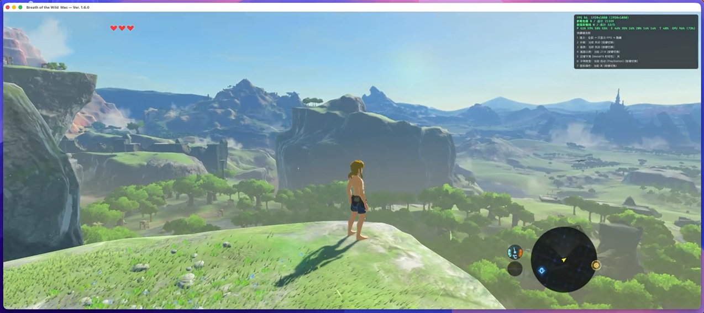

# MacNativeGames

<b>Play your own Tears of the Kingdom and Breath of the Wild natively on Apple silicon Mac, iPhone and iPad.</b> 
Not an emulator: the game's own ARM64 code runs directly on Apple chips, and its NVN graphics are rebuilt on Metal.

# English

**Breath of the Wild 1.6.0 and 1.9.0 are now officially supported on Mac!** 1.6.0 also runs on the iPhone (first played on an iPhone 14, October 23).
**Tears of the Kingdom 1.0.0, 1.2.1 and 1.4.3 are now officially supported on Mac, iPhone and iPad!**

| Game | Version | Platform | Status | Folder |
|---|---|---|---|---|
| The Legend of Zelda: Tears of the Kingdom | 1.0.0, 1.2.1, 1.4.3 (1.1.2 builds too) | Mac, iPhone, iPad; Apple Vision Pro (windowed, early) | Supported | [`games/totk`](docs/install.md) ([Vision Pro](docs/install.md#apple-vision-pro)) |
| The Legend of Zelda: Breath of the Wild | 1.6.0, 1.9.0 | Mac; 1.6.0 also on the iPhone | Supported | [`games/totk`](docs/install.md#breath-of-the-wild-160-and-190-early) (shared runtime), list in `games/botw` |
| Super Smash Bros. Ultimate | 13.0.2 | Mac | Community port | [`games/ssbu`](games/ssbu/README.md) |
| Super Mario Odyssey | 1.3.0 | Mac | Community port, early | [`games/odyssey`](games/odyssey/README.md) |
| Bayonetta 3 | 1.2.0 | Mac | Community port, work in progress | [`games/by3`](games/by3/README.md) |
| Super Mario Bros. Wonder | 1.0.0, 1.2.1 | Mac | Community port, early | [`games/wonder`](games/wonder/README.md) |
| Ori and the Blind Forest: Definitive Edition | 1.0.1 | Mac | Community port | [`games/ori`](games/ori/README.md) |
| Super Mario Party Jamboree | 2.3.0 | Mac | Community port, experimental | [`games/jamboree`](games/jamboree/README.md) |
| Mario vs. Donkey Kong | 1.0.1 | Mac | Community port, early | [`games/mvdk`](games/mvdk/README.md) |

Community ports keep their own runtime, graphics layer and scripts in their folder and are built with the steps there.

> **Recommended: let an AI assistant install and test it for you.** Open this repository in Claude Code, Codex, or any other AI assistant you like, tell it where your own game file and `prod.keys` are, and ask it to build and install the app and to sort out whatever comes up on your Mac. It reads [docs/install.md](docs/install.md), runs every step and checks the result; you just wait with a coffee. Installing and testing by hand is not recommended: there are many steps, and every Mac, game version and dump is a little different. That's why I haven't provided a one-click build option: an AI assistant is my one-click build option.

[English](#english) | [中文](#chinese)

## Legal

**You must own the game.** Use this project only with a copy of The Legend of Zelda: Tears of the Kingdom that you bought, and with keys and system files dumped from your own Nintendo Switch. This is an independent, non-commercial project. It is not affiliated with, endorsed by, or sponsored by Nintendo. The Legend of Zelda and Nintendo Switch are trademarks of Nintendo.

The repository contains no game content and distributes none: no game program, art, text, audio, shaders or keys. Everything the game needs is made on your own computer from your own files when you build the app. The app you build contains the game, so it is for your own use only; do not share it. What the repository does hold is the information needed to make the port work: the patch code, the addresses and hashes used to check your files, and the [shared shader list](docs/shader-list.md), which names shaders and bind states but contains no shader code.

Play your own copy of **The Legend of Zelda: Tears of the Kingdom** natively on Apple silicon Mac, iPhone, and iPad. Bring your game file (XCI or NSP) and your `prod.keys`; one script builds a Mac app or an unsigned iPhone/iPad IPA. The iOS build requires iOS/iPadOS 26 and iPhone 14 or newer. It is not an emulator: the game's own ARM64 code runs directly on Apple chips (rewritten where the operating system requires it), the Switch system services are answered by a small host, and the game's NVN graphics are rebuilt on Metal. Nothing from the game is in this repository, and the project is not affiliated with Nintendo. Version 1.4.3 has been played on an iPhone 14 and an iPad; see [iPhone and iPad](docs/install.md#iphone-and-ipad).

## Let's maintain the shader list together: no more stutter

> [!TIP]
> **Every shader in the shared list is ready before you play.** On a Mac the game does not stop to compile it, and on an iPhone or iPad nothing is missing from the picture. The more places players cover, the smoother the game gets for everyone.

The [shared shader list](docs/shader-list.md) now holds **17,155 shader variants** (15,724 shaders) from the Mac, iPhone and iPad: only states a build does not make by itself, since every build makes each shader's default variant. Every build makes them from the player's own game files, so the list holds identifiers only, never game data. Helping takes no setup:

1. **Play.** Every build carries each shader of the game for its default bind state. When your game meets a shader in a state that variant does not serve, or builds a render pipeline the app's list lacks, it notes it in `shader-list-contribution.txt`; default variants are never noted.
2. **On a Mac, every 100 new rows (shaders and pipelines together) it asks you once, before the game starts.** Click "Send": the GitHub form opens and the file is shown, ready to drag in. If the GitHub CLI (`gh`) is installed and signed in, the dialog offers "Submit automatically" instead, which sends this batch for you (a private gist and an issue) without opening the browser. An iPhone or iPad never asks during play: while it is connected to the Mac that built its app (cable or the same Wi-Fi), the Mac asks instead. "Don't remind me again" stops the reminders.
3. **Everyone's next build carries them.** Nobody stutters there again.

**[Send your shaders →](https://github.com/ly05010419/MacNativeGames/issues/new?template=shader-list.yml)** · The game never uploads anything by itself.

Update history:

| Date | Platform | Update |
|---|---|---|
| Oct 25 | Mac | **Super Mario Party Jamboree 2.3.0** (community port, experimental): independent [`games/jamboree`](games/jamboree/README.md) build, vertex-storage writes during rasterizer discard fix character deformation; tested scope and limitations documented |
| Oct 24 | Mac | **Super Smash Bros. Ultimate 13.0.2** (community port): fights, World of Light with the Spirit Board, saves, movies with sound; 1080p or 2K; own runtime in [`games/ssbu`](games/ssbu/README.md), with its one-command build there |
| Oct 23 | iPhone | **Breath of the Wild 1.6.0** on the iPhone: full screen, add-on content, saves copied from the Mac; both games render at 960x540 on the phone and use their own upscale to 1280x720 (no MetalFX) |
| Oct 23 | Mac | **Super Mario Odyssey 1.3.0** (community port, early): Cap Kingdom and Bonneton playable at 60 fps on an M3, own runtime in [`games/odyssey`](games/odyssey/README.md), which has the build steps |
| Oct 23 | iPhone, iPad | **Tears of the Kingdom** fills the screen, 60 fps by default, MetalFX upscaling |
| Oct 23 | Mac | **Breath of the Wild 1.6.0**: key 2 interpolates again, and Link no longer shakes at 30+30; key 3 switches to native 2K; key 4 (21:9 ultrawide) and key 5 (edge smoothing) now work; every shader is prepared at build time, so far fewer translate in play |
| Oct 23 | Mac | **Tears of the Kingdom** renders its 3D scene at the canvas resolution: internal 1920x1080 at 1080p (docked was only 1600x900), 2560x1440 on the 2K canvas |
| Oct 21 | Mac | **Breath of the Wild 1.9.0**: shaders and render pipelines optimised |
| Oct 21 | Mac, iPhone, iPad | **Tears of the Kingdom**: steadier at 90 fps, and steadier frame rates when no shaders are cached at all |
| Oct 20 | Mac | **Bayonetta 3 1.2.0** (community port, work in progress): title, menus and the story run with picture, sound, keyboard input and saves; own runtime in [`games/by3`](games/by3/README.md), which has the build steps |
| Oct 20 | Mac | **Breath of the Wild 1.9.0** (early): a base NSP and the 1.9.0 update NSP build the same app, each DLC pack optional (`--dlc`) |
| Oct 20 | Mac | **Breath of the Wild 1.6.0** (early): a card image holding the base game, the update and the add-on content builds its own app with the same command; title, saves, the Great Plateau and DLC packs work |
| Oct 19 | Mac | Key 4 switches to a true 21:9 ultrawide view and back (1.2.1, 1.4.3); the HUD keeps its shape in the middle 16:9 |
| Oct 19 | iPhone, iPad | Tested with 1.4.3: a fresh install shows the game from the first launch, without a played cache |
| Oct 19 | All | The game notes the shaders the shared list lacks; on a Mac, every 500 it asks to send them in a [GitHub issue](https://github.com/ly05010419/MacNativeGames/issues/new?template=shader-list.yml) |
| Oct 19 | All | One shared [shader list](docs/shader-list.md); the build reads every shader in the game data (15,266 prepared for 1.4.3) |
| Oct 19 | Mac | 1.2.1 support (the most widely used update), with the same build command |
| Oct 19 | Mac | FPS, shader and load readings and the shortcut reminder in one small box in the window's top-right corner (`TOTK_HUD=corners` keeps the old layout) |
| Oct 18 | iPhone, iPad | IPA build target |
| Oct 18 | Mac | 1.4.3 support and shader prewarming: the title screen waits only for its own shaders (about 2 seconds), the rest warm in the background |
| Oct 17 | Mac | 1.0.0 and 1.1.2 support; no first-launch shader prewarming yet, so new scenes could stutter |

**Stuttering when you first start playing or enter a new scene is expected while new shaders compile—don't be surprised.** Performance typically improves as the cache warms up, and every shader the [shared list](#lets-maintain-the-shader-list-together-no-more-stutter) gains is one nobody stutters on again.

## Install and play

Everything from building the app to playing is in **[docs/install.md](docs/install.md)**. The recommended way is to hand it to an AI assistant (see the top of this page) rather than run the steps yourself:

- [What you need](docs/install.md#what-you-need) · [Build the app](docs/install.md#build-the-app) · [Breath of the Wild](docs/install.md#breath-of-the-wild-160-and-190-early) · [iPhone and iPad](docs/install.md#iphone-and-ipad) · [Apple Vision Pro](docs/install.md#apple-vision-pro)
- [Controls](docs/install.md#controls) · [Where things are](docs/install.md#where-things-are) · [Known issues](docs/install.md#known-issues)
- [Local testing](docs/install.md#local-testing) · [Audio fix](docs/install.md#audio-fix)

## How it works

See [docs/how-it-works.md](docs/how-it-works.md).

Recorded performance experiments, remaining work and comparison methods: [Mac performance follow-ups](docs/performance-followups.md).

## Acknowledgements

- **[d2r-mobile](https://github.com/jhaizhou-ops/d2r-mobile)** (MIT) developed this way of running Switch games natively (for Diablo II: Resurrected): the NSO rewriter, the Horizon host and the NVN-on-Metal layer here started as its generic parts.
- **[nxnative](https://github.com/seedds/nxnative)**: the one-script packaging and NSP common-ticket import follow its approach.
- **Ryujinx** (MIT): its shader translator (`vendor/ryujinx`) turns the game's Maxwell shaders into SPIR-V, and its system-service code is a reference. With this project's patches and service it is compiled ahead of time (.NET NativeAOT) into `games/totk/prebuilt/macos-arm64/totk_xlate`; `games/totk/tools/totk_xlate/publish_native.sh` rebuilds it (needs the .NET 10 SDK, only for developers).
- **[SPIRV-Cross](https://github.com/KhronosGroup/SPIRV-Cross)** (Apache-2.0) turns SPIR-V into Metal Shading Language; it is fetched at a pinned commit and compiled with clang during the build.
- **deko3d** (zlib): texture layout sizes. **bcdec**: BC texture decoding. **libopus** and **libvpx** (BSD) from Homebrew: audio and the pre-rendered movies.

## License

MIT (see [LICENSE](LICENSE)). Third-party code keeps its own license: [THIRD_PARTY_NOTICES.md](THIRD_PARTY_NOTICES.md).

---

# 中文说明

**正式支持旷野之息 1.6.0 和 1.9.0 mac了！** 1.6.0 也能在 iPhone 上玩了（10 月 23 日在 iPhone 14 上首次实玩）。
**正式支持王国之泪 1.0.0,1.2.1，1.4.3 Mac iPhone iPad了！**

| 游戏 | 版本 | 平台 | 状态 | 目录 |
|---|---|---|---|---|
| 塞尔达传说 王国之泪 | 1.0.0、1.2.1、1.4.3（1.1.2 也能打包） | Mac、iPhone、iPad；Apple Vision Pro（窗口内游玩，早期） | 正式支持 | [`games/totk`](docs/install.zh-CN.md)（[Vision Pro](docs/install.zh-CN.md#apple-vision-pro)） |
| 塞尔达传说 旷野之息 | 1.6.0、1.9.0 | Mac；1.6.0 也能在 iPhone 上玩 | 正式支持 | [`games/totk`](docs/install.zh-CN.md#旷野之息-160-和-190早期)（共用运行时），清单在 `games/botw` |
| 任天堂明星大乱斗 特别版 | 13.0.2 | Mac | 社区移植 | [`games/ssbu`](games/ssbu/README.md) |
| 超级马力欧 奥德赛 | 1.3.0 | Mac | 社区移植，早期 | [`games/odyssey`](games/odyssey/README.md) |
| 猎天使魔女 3 | 1.2.0 | Mac | 社区移植，开发中 | [`games/by3`](games/by3/README.md) |
| 超级马力欧兄弟 惊奇 | 1.0.0、1.2.1 | Mac | 社区移植，早期 | [`games/wonder`](games/wonder/README.md) |
| 奥日与黑暗森林 终极版 | 1.0.1 | Mac | 社区移植 | [`games/ori`](games/ori/README.md) |
| 超级马力欧派对 空前盛会 | 2.3.0 | Mac | 社区移植，实验 | [`games/jamboree`](games/jamboree/README.md) |
| 马力欧 vs. 大金刚 | 1.0.1 | Mac | 社区移植，早期 | [`games/mvdk`](games/mvdk/README.md) |

社区移植的游戏各自在自己的目录里带一份运行时、图形层和脚本，按那里的步骤构建。

> **推荐的安装测试方式：交给 AI 助理。** 用 Claude Code、Codex 或其他你喜欢的 AI 助理打开这个仓库，告诉它你自己的游戏文件和 `prod.keys` 在哪，让它帮你打包、安装 App，遇到这台 Mac 上的问题也让它处理。它会读 [docs/install.zh-CN.md](docs/install.zh-CN.md)，一步步跑完并检查结果，你只需要喝杯咖啡等着。不推荐自己手动安装测试：步骤多，每台 Mac、每个游戏版本、每份导出的游戏文件都有些差别。这也是我没有提供一键打包的原因：AI 助理就是我的一键打包。

[英文说明](#english) | [中文说明](#chinese)

## 法律声明

**你必须拥有正版游戏。** 请只配合你自己购买的《塞尔达传说 王国之泪》，以及从你自己的 Nintendo Switch 导出的密钥和系统文件使用本项目。这是一个独立的非商业项目，与任天堂没有关联，也未获其认可或赞助。The Legend of Zelda（塞尔达传说）和 Nintendo Switch 是任天堂的商标。

本仓库不含、也不分发任何游戏内容：没有游戏程序、美术、文字、音频、着色器或密钥。游戏需要的一切，都是打包时在你自己的电脑上、用你自己的文件生成的。打包出的 App 里含有游戏，只供你自己使用，请不要分享。仓库里有的是让移植能运行的信息：补丁代码、用来核对你的文件的地址和哈希，以及[公共着色器清单](docs/shader-list.md)（只记着色器和绑定状态的标识，不含着色器代码）。

在 Apple 芯片的 Mac、iPhone 和 iPad 上原生运行你自己拥有的**《塞尔达传说 王国之泪》**。准备好游戏文件（XCI 或 NSP）和你的 `prod.keys`，一个脚本即可构建 Mac App 或未签名的 iPhone / iPad IPA。iOS 构建需要 iOS / iPadOS 26，最低支持 iPhone 14。这不是模拟器：游戏自己的 ARM64 代码直接运行在苹果芯片上（按操作系统要求改写），Switch 的系统服务由一个小宿主应答，游戏的 NVN 图形在 Metal 上重建。本仓库不含任何游戏内容，项目与任天堂无关。1.4.3 已在 iPhone 14 和 iPad 上实际游玩，见 [iPhone 和 iPad](docs/install.zh-CN.md#iphone-和-ipad)。

## 让我们一起维护着色器清单：游戏不再卡顿

> [!TIP]
> **公共清单里的每个着色器，开玩之前就已经准备好。** Mac 上不用停下来现场编译，iPhone 和 iPad 上画面也不会缺东西。大家玩过的地方越多，所有人玩得越流畅。

[公共着色器清单](docs/shader-list.md)现在有 **17,155 个着色器变体**（15,724 个着色器），来自 Mac、iPhone 和 iPad：只收打包自己做不出的状态，因为每次打包都会给每个着色器做好默认变体。每次打包都用玩家自己的游戏文件生成，所以清单里只有标识，不含任何游戏数据。参与不需要任何设置：

1. **照常玩。** 每次打包都会把游戏里每个着色器按默认绑定状态各备一份。游戏遇到默认那份用不了的状态，或者建了 App 清单里没有的渲染管线，才会记进 `shader-list-contribution.txt`；默认变体不记。
2. **在 Mac 上，着色器和管线合计每攒够 100 条，它会在游戏启动前问你一次。** 点“发送”，GitHub 提交页面会打开，文件也会显示出来，拖进去就行。装了 GitHub 命令行工具（`gh`）并已登录时，对话框里会多一个“自动提交”，点了就直接替你把这一批发出去（私密 gist 加一个 issue），不用打开浏览器。iPhone 和 iPad 玩的时候从不提醒：设备连着打包它的那台 Mac（线连或同一 Wi‑Fi）时，由 Mac 来问。点“不要提醒了”以后就不再问。
3. **下次大家打包的 App 都会带上。** 谁到那里都不会再卡顿。

**[发送你的着色器 →](https://github.com/ly05010419/MacNativeGames/issues/new?template=shader-list.yml)** · 游戏不会自己上传任何东西。

更新历史：

| 日期 | 平台 | 更新 |
|---|---|---|
| 10 月 25 日 | Mac | **超级马力欧派对 空前盛会 2.3.0**（社区移植，实验）：独立构建，放在 [`games/jamboree`](games/jamboree/README.md)；光栅化丢弃时照样执行顶点存储写入，修好了角色变形；测过的范围和已知限制写在那里 |
| 10 月 24 日 | Mac | **任天堂明星大乱斗 特别版 13.0.2**（社区移植）：对战、灯火之星和命魂板、存档、带声音的过场动画；1080p 或 2K；运行时独立放在 [`games/ssbu`](games/ssbu/README.md)，一条命令构建，步骤见那里 |
| 10 月 23 日 | iPhone | **旷野之息 1.6.0** 上 iPhone：铺满屏幕、带 DLC、可拷入 Mac 的存档；两款游戏在手机上都是内部 960×540，用游戏自己的放大到 1280×720（不用 MetalFX） |
| 10 月 23 日 | Mac | **超级马力欧 奥德赛 1.3.0**（社区移植，早期）：帽子王国和 Bonneton 在 M3 上 60 帧可玩，运行时独立放在 [`games/odyssey`](games/odyssey/README.md)，构建步骤见那里 |
| 10 月 23 日 | iPhone、iPad | **王国之泪** 铺满屏幕 默认锁 60、MetalFX放大|
| 10 月 23 日 | Mac | **旷野之息 1.6.0**：2 键补帧恢复，30+30 下林克不再抖；3 键可以切到原生 2K；4 键（21:9 宽屏）和 5 键（边缘平滑）可以用了；打包时准备好全部着色器，游玩中当场翻译的少了很多 |
| 10 月 23 日 | Mac | **王国之泪** 3D 画面按画布分辨率渲染：1080p 内部分辨率 1920x1080（原来底座模式只有 1600x900），2K 画布时 2560x1440|
| 10 月 21 日 | Mac | **旷野之息 1.9.0** 优化了着色器和渲染管线 |
| 10 月 21 日 | Mac、iPhone、iPad | **王国之泪** 提高90帧稳定性，提高完全没有着色器时帧数稳定 |
| 10 月 20 日 | Mac | **猎天使魔女 3 1.2.0**（社区移植，开发中）：标题、菜单和剧情能跑，有画面、声音、键盘输入和存档；运行时独立放在 [`games/by3`](games/by3/README.md)，构建步骤见那里 |
| 10 月 20 日 | Mac | **旷野之息 1.9.0**（早期）：本体 NSP + 1.9.0 更新 NSP 打成同一个 App，每个 DLC 内容包都可选（`--dlc`） |
| 10 月 20 日 | Mac | **旷野之息 1.6.0**（早期）：本体 + 更新 + 追加内容合在一起的卡带镜像用同一条命令打成单独的 App；标题、存档、初始台地和 DLC 内容包都能用 |
| 10 月 19 日 | Mac | 按 4 切换真正的 21:9 超宽画面（1.2.1、1.4.3），HUD 保持原比例、在中间 16:9 区域 |
| 10 月 19 日 | iPhone、iPad | 用 1.4.3 实测：全新安装、没有玩过的缓存，第一次启动就能看到游戏画面 |
| 10 月 19 日 | 全部 | 游戏会记下公共清单里还没有的着色器；Mac 上每攒够 500 个提醒一次用 [GitHub Issue](https://github.com/ly05010419/MacNativeGames/issues/new?template=shader-list.yml) 发送 |
| 10 月 19 日 | 全部 | 所有平台共用一份[着色器清单](docs/shader-list.md)；打包时读取游戏数据里的全部着色器（1.4.3 准备 15,266 个） |
| 10 月 19 日 | Mac | 支持 1.2.1（玩家最多的版本），构建命令不变 |
| 10 月 19 日 | Mac | FPS、着色器、负载读数和快捷键说明集中到窗口右上角一个小框里（`TOTK_HUD=corners` 保留原来的布局） |
| 10 月 18 日 | iPhone、iPad | 加入 IPA 构建目标 |
| 10 月 18 日 | Mac | 支持 1.4.3，并加入着色器预热：标题画面只等它自己用到的着色器（约 2 秒），其余在后台预热 |
| 10 月 17 日 | Mac | 支持 1.0.0 和 1.1.2；当时还没有首次启动着色器预热，进入新场景可能卡顿 |

**第一次进入游戏或新场景时，新着色器的编译可能造成卡顿，这是预期现象，不必惊讶。** 随着着色器缓存逐步预热，表现通常会改善；[公共清单](#让我们一起维护着色器清单游戏不再卡顿)每多一个着色器，就少一处卡顿。

## 安装与游玩

从打包 App 到开始游玩的全部步骤见 **[docs/install.zh-CN.md](docs/install.zh-CN.md)**。推荐交给 AI 助理去跑（见本页开头），不推荐自己一步步手动操作：

- [需要准备](docs/install.zh-CN.md#需要准备) · [打包 App](docs/install.zh-CN.md#打包-app) · [旷野之息](docs/install.zh-CN.md#旷野之息-160-和-190早期) · [iPhone 和 iPad](docs/install.zh-CN.md#iphone-和-ipad) · [Apple Vision Pro](docs/install.zh-CN.md#apple-vision-pro)
- [操作](docs/install.zh-CN.md#操作) · [文件位置](docs/install.zh-CN.md#文件位置) · [已知问题](docs/install.zh-CN.md#已知问题)
- [本机测试](docs/install.zh-CN.md#本机测试) · [音频修复](docs/install.zh-CN.md#音频修复)

## 工作原理

见 [docs/how-it-works.md](docs/how-it-works.md)。

已做的性能实验、待办与对比方法见 [Mac 性能待做](docs/performance-followups.md)。

## 致谢

- **[d2r-mobile](https://github.com/jhaizhou-ops/d2r-mobile)**（MIT）为《暗黑破坏神 II：狱火重生》开发了这套原生运行 Switch 游戏的方法：这里的 NSO 改写器、Horizon 宿主和 Metal 上的 NVN 层都从它的通用部分起步。
- **[nxnative](https://github.com/seedds/nxnative)**：“用户自己的游戏文件 + 一个脚本出包”和 NSP 通用票据读取的做法借鉴自它；本项目只构建 Mac App。
- **Ryujinx**（MIT）：它的着色器翻译器（`vendor/ryujinx`）把游戏的 Maxwell 着色器转成 SPIR-V，它的系统服务代码也是参考。加上本项目的补丁和着色器服务，用 .NET NativeAOT 预先编成原生程序 `games/totk/prebuilt/macos-arm64/totk_xlate`；改了翻译器用 `games/totk/tools/totk_xlate/publish_native.sh` 重编（要 .NET 10 SDK，只有开发者需要）。
- **[SPIRV-Cross](https://github.com/KhronosGroup/SPIRV-Cross)**（Apache-2.0）把 SPIR-V 转成 Metal 着色语言；打包时按固定提交取得，用 clang 编。
- **deko3d**（zlib）：贴图布局尺寸。**bcdec**：BC 贴图解码。**libopus**、**libvpx**（BSD，来自 Homebrew）：音频和预渲染影片。

## 许可证

MIT（见 [LICENSE](LICENSE)）。第三方代码保留各自的许可证：[THIRD_PARTY_NOTICES.md](THIRD_PARTY_NOTICES.md)。
